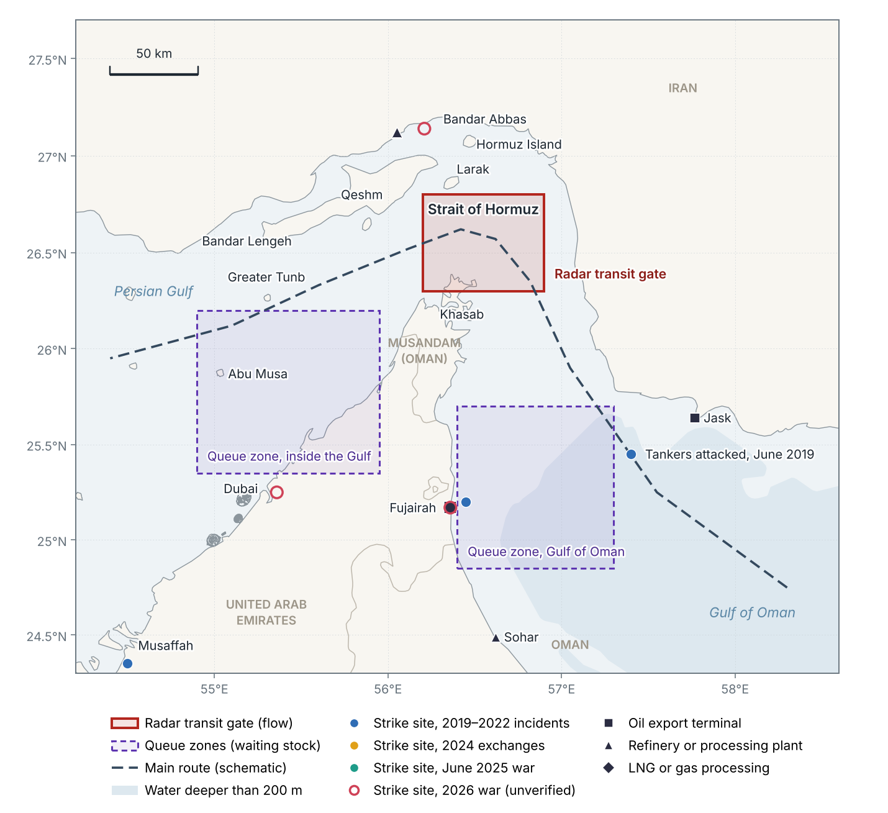
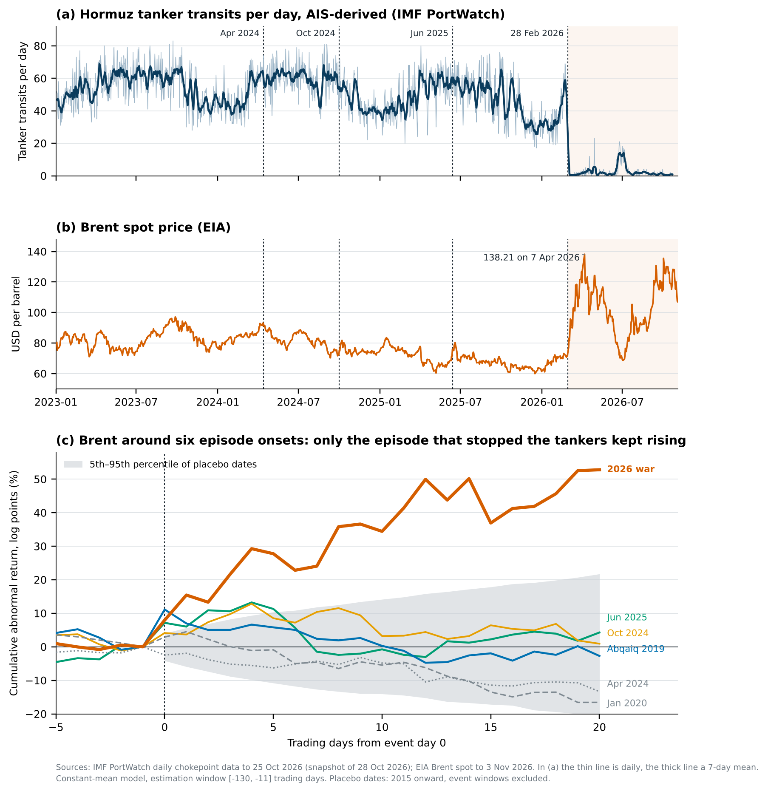
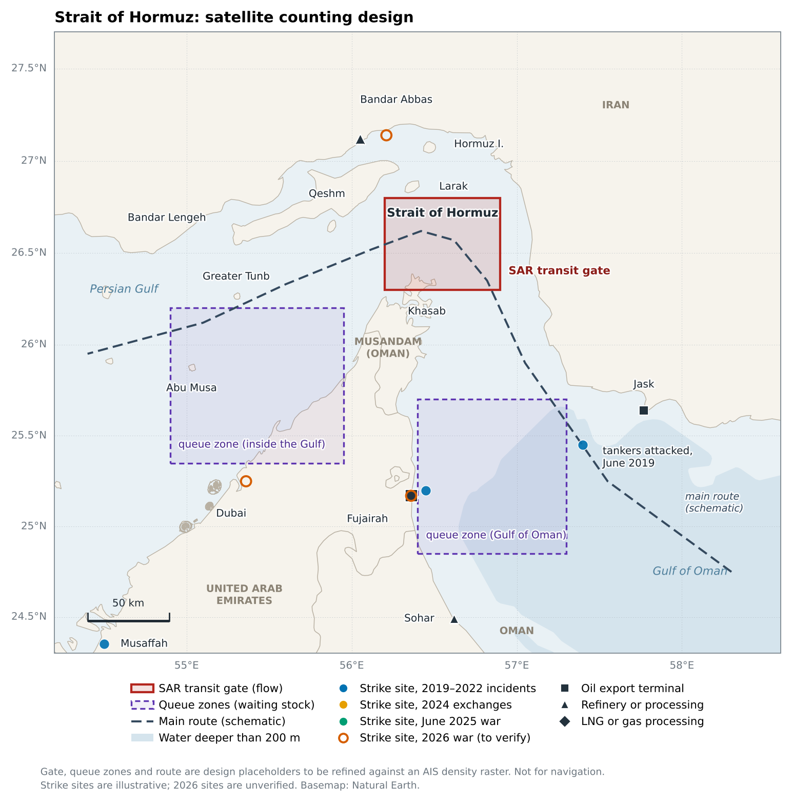

<p align="center"><a href="paper/paper.pdf"></a></p>

<p align="center">
<a href="requirements.txt"></a>
<a href="paper/paper.pdf"></a>
<a href="tests/"></a>
<a href="#data"></a>
<a href="#what-has-been-run"></a>
<a href="#before-citing-or-extending"></a>
</p>

<p align="center">
📄 <b><a href="paper/paper.pdf">Download the PDF</a></b> ·
📊 <b><a href="outputs/tables/">Results tables</a></b> ·
🖼️ <b><a href="outputs/figures/">Figures</a></b> ·
🗂️ <b><a href="#data">Data sources</a></b> ·
⚙️ <b><a href="config.yaml">Config</a></b>
</p>

**Satellite-observed shipping in the Strait of Hormuz, missile strikes and global energy prices.** The project asks
whether missile and drone strikes move energy prices by taking barrels off the water or by raising a risk premium. It
builds a satellite transit index for the Strait of Hormuz (Sentinel-1 radar fused with AIS), a spatial strike-exposure
index, and an event-study / local-projection design that separates the two channels.



> **Status notice.** No Sentinel-1 scene has been processed yet. The CFAR detector and the SAR-AIS fusion are tested on
> **simulated** scenes and traffic only; the detector's thresholds are tuned on Gamma-distributed clutter, and real sea
> clutter is rougher. The event study and local projections run on real EIA Brent and IMF PortWatch data. The 2026 rows
> of the strike reference table are **unverified**. See [What has been run](#what-has-been-run).

## Install and quickstart

```bash
pip install -r requirements.txt
python fetch_basemap.py      # Natural Earth layers for the maps, about 40 MB
python run_all.py            # tables -> outputs/tables, figures -> outputs/figures
python -m pytest -q tests    # 14 tests
```

`run_all.py` works offline on the two data snapshots in `data/raw`. Add `--refresh` to re-download prices and
PortWatch transits first.

| Command | Purpose |
|---|---|
| `python run_all.py` | Event study, local projections, exposure layer, all tables and figures |
| `python run_all.py --refresh` | Same, after re-downloading prices and PortWatch transits |
| `python fetch_basemap.py` | Natural Earth basemap layers (not shipped) |
| `python paper/fig_maps.py` | Figures 1-3 (maps) |
| `python paper/fig_charts.py` | Figures 4, 6-8 (data and method charts) |
| `python paper/fonts/make_fonts.py` | Optional: Inter as TrueType for clean PDF embedding |
| `latexmk -pdf main.tex` (in `paper/`) | Build the preprint (needs TeX Live) |

Each figure script ends with an automatic check that reports any overlapping or clipped text; every figure in the
paper passes with zero overlaps. `paper/main.bbl` is included, so the paper also compiles without BibTeX (this is the
form arXiv expects).

## What the pipeline does

1. **Configuration** (`config.yaml`): every threshold, area of interest and window. The gate, queue zones and route
   are placeholders; redraw them against an AIS density raster. Not for navigation.
2. **Vessel detection** (`src/s1_cfar.py`, `src/s1_gee_pipeline.py`): CA-CFAR detector and object measurement on
   Sentinel-1 radar, with an Earth Engine pipeline for scenes, sea mask, detection and exports.
3. **Transit index** (`src/flow_index.py`): Little's law turns queue counts into flows; a Kalman filter fuses SAR
   detections with AIS transit counts.
4. **Strike exposure** (`src/strike_exposure.py`): a spatial exposure index of strikes on energy infrastructure and
   its daily shock series.
5. **Data** (`src/data_sources.py`): loaders for EIA/FRED prices, IMF PortWatch and ACLED.
6. **Inference** (`src/event_study.py`, `src/local_projections.py`): abnormal returns with t and placebo inference;
   impulse responses with HAC or lag-augmented errors.
7. **Deliverables**: tables in `outputs/tables/`, figures in `outputs/figures/`, and the preprint in `paper/`.

## What has been run

| Component | Status |
| --- | --- |
| Event study, placebo inference | Tested; run on real Brent data |
| Local projections | Monte Carlo checked; run on real weekly data |
| CFAR detector | Tested on **simulated** scenes only |
| SAR-AIS fusion | Tested on **simulated** traffic only |
| Exposure index | Tested; run on the reference layer |
| Maps and charts | Run |
| `s1_gee_pipeline.py` | **Not run.** Needs an Earth Engine account. Expect small fixes on first run |
| Live FRED, PortWatch and ACLED clients | **Not run.** The PortWatch URL and query pattern match a public replication package that used them on 2026-10-28. The ACLED client is written from memory of the 2025 API; check the current documentation |

## Research: *Orbital Evidence on Chokepoint Risk: Satellite-Observed Shipping in the Strait of Hormuz, Missile Strikes, and Global Energy Prices*

The preprint by Thanatchon Chongmankhong (November 2026) is in [`paper/`](paper/): a 13-page PDF in
[`paper/paper.pdf`](paper/paper.pdf) and its LaTeX source in [`paper/main.tex`](paper/main.tex) with
[`paper/refs.bib`](paper/refs.bib), set in the arXiv preprint style ([`paper/arxiv.sty`](paper/arxiv.sty)).

`outputs/tables/` holds what `run_all.py` produced on 2026-11-10 from EIA Brent spot (to 2026-11-03) and IMF
PortWatch (to 2026-10-25):

- `event_study_brent.csv`: six episode onsets, 2019-2026. Brent rose 7-11 log points on day 0 in three of them; only
  the 2026 episode, when AIS-observed tanker transits fell 97%, kept rising (+52.8 by day 20, placebo p = 0.015).
- `flow_response.csv`: transit change in the first week after each onset.
- `lp_calm_weekly.csv`: in 164 calm weeks a 10% fall in tanker transits is followed by a Brent change of +0.14%
  (90% interval -0.28 to +0.56).
- `closure_weekly.csv`, `spread_response.csv`, `summary.json`.

Six events, one of them with flow loss, motivate hypotheses. They test nothing.

<p align="center"></p>

## Repository layout

```
config.yaml                 every threshold, area of interest and window
run_all.py                  rebuilds all tables and figures
fetch_basemap.py            downloads the Natural Earth basemap layers
src/
  s1_cfar.py                CA-CFAR vessel detector, object measurement, synthetic scenes
  s1_gee_pipeline.py        Earth Engine: scenes, sea mask, detection, exports
  flow_index.py             Little's law, SAR-AIS Kalman fusion, export post-processing
  strike_exposure.py        exposure index and daily shock series
  data_sources.py           loaders: EIA/FRED prices, IMF PortWatch, ACLED
  event_study.py            abnormal returns, t and placebo inference
  local_projections.py      impulse responses (HAC or lag-augmented errors)
  make_figures.py           Figures 1-3 and two demonstration figures
tests/                      unit tests against known answers
data/raw/                   price and transit snapshots (see "Data")
data/reference/             small hand-built tables (see "Reference tables")
outputs/                    tables and figures as produced on 2026-11-10
paper/
  paper.pdf                 the compiled preprint (13 pages)
  main.tex, refs.bib        LaTeX source and bibliography (main.bbl prebuilt)
  arxiv.sty                 arXiv preprint style (github.com/kourgeorge/arxiv-style)
  figlib.py                 figure house style, label placement, overlap audit
  fig_maps.py, fig_charts.py   scripts for every figure in the paper
  figures/                  vector PDFs used by the paper, PNG previews
  fonts/make_fonts.py       converts Inter to TrueType for figure embedding
```

## Data

| File | Source | Notes |
| --- | --- | --- |
| `data/raw/brent-daily.csv`, `wti-daily.csv` | U.S. EIA spot prices via github.com/datasets/oil-prices | Retrieved 2026-11-10 |
| `data/raw/portwatch_daily_2023_2026_mirror.csv` | IMF PortWatch Daily Chokepoints Data, API responses of 2026-10-28, via github.com/tanmaydesh/hormuz-chokepoint-oil | Five chokepoints, 2023-01-01 to 2026-10-25. Checked row by row against the raw API responses in that repository. Pull the full history from the IMF before publication: `load_portwatch("hormuz", refresh=True)` |
| `data/naturalearth/*.geojson` | Natural Earth 1:10m via github.com/nvkelso/natural-earth-vector | Not shipped; `fetch_basemap.py` downloads them |

ACLED data are not shipped and may not be redistributed. Download an export with your own account and pass it to
`data_sources.load_acled_csv()`.

### Reference tables (read this before using them)

- `strike_events_reference.csv`: 44 well-known strike sites compiled by hand to demonstrate the mapping workflow.
  Rows with `confidence = verify` (all 2026 rows) are recalled from open-source reporting and are **unverified**. No
  estimate uses this file. Build the analysis layer from ACLED.
- `energy_infrastructure.csv`: 22 assets with **indicative** capacities. Replace with Global Energy Monitor and EIA
  records.
- `episode_onsets.csv`: the six onsets used in the preliminary event study, with the first trading day whose close
  postdates each event.

## Going from simulated to real satellite data

1. `earthengine authenticate`, then `s1_gee_pipeline.ee_init("<project>")` and `revisit_table("gate", start, end)` to
   see the true pass cadence.
2. `export_detections("gate", start, end)` one year at a time; repeat for `queue_oman` and `queue_gulf`.
3. `flow_index.detections_to_counts()` on the exports, then `flow_index.kalman_fuse()` with PortWatch counts.
4. `export_chips()` for a validation month; run `s1_cfar.detect_vessels()` on the chips and compare with the
   server-side detections. Tune the detector on a hand-labelled sample before trusting any count.
5. ACLED export -> `load_acled_csv()` -> `strike_exposure.exposure_index()` -> `daily_exposure()` ->
   `local_projections.local_projection()`.

## Release rules

Publish aggregate counts and indices only, at least 30 days after the pass they describe. No vessel-level positions,
tracks or identities.

## Limitations

No Sentinel-1 scene processed; detector and fusion validated on simulated data only; six episodes give the event study
little power; hand-built reference tables with unverified 2026 rows; placeholder areas of interest; Earth Engine and
live API clients not yet run.

## Before citing or extending

- The bibliography in `paper/refs.bib` was compiled without database access. Check every author, year, volume and page
  against the publisher's record.
- No licence file is included yet. Choose one before making the repository public (for example MIT for the code and
  CC BY 4.0 for the paper). Data snapshots remain under their providers' terms (EIA, IMF PortWatch, Natural Earth), and
  `arxiv.sty` under the terms of its original repository.
